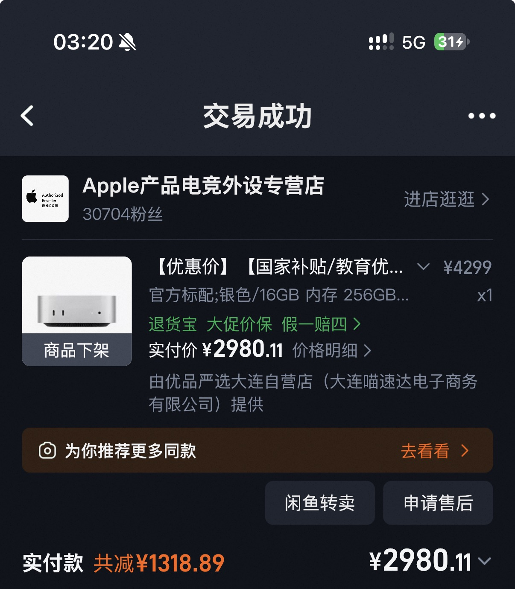
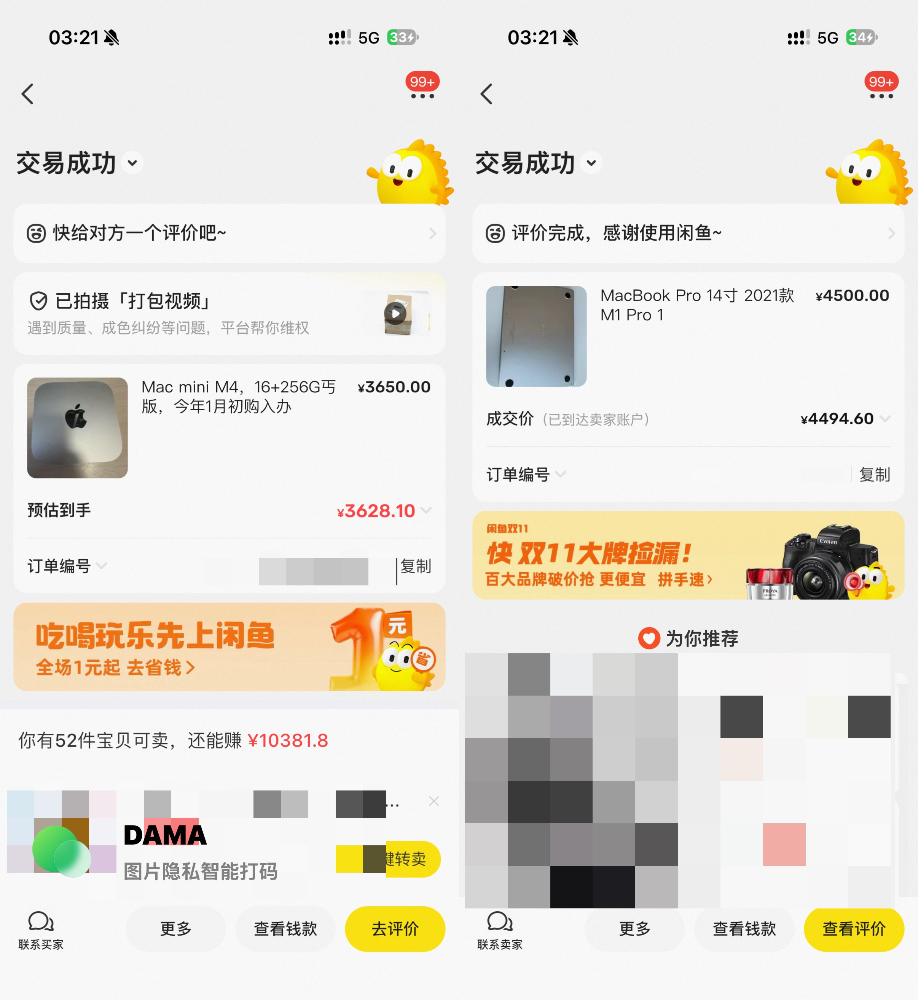
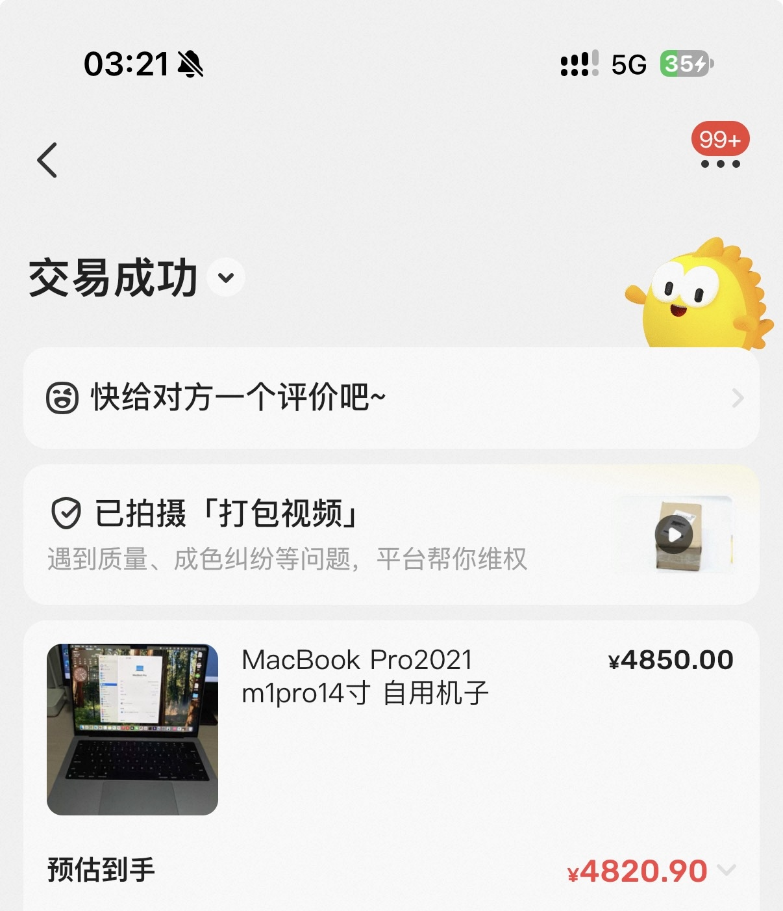

今年一月突发奇想，决定把自己的 Windows 台式机换成 Mac mini M4

当时想换机是因为我确实有短期出行带电脑的需求，当时又只有一台台式机，根本没办法带，一出门就没电脑。左看右看发现 Mac mini 本体非常便携，并且可以联动我手上的 iPad 做无头随航，直接把 iPad 当做便携显示器，然后再带一个键鼠就可以直接用。更关键的是 Mac mini 比同配置的 Air 便宜很多，当时还有末班车，淘宝叠完国补、教育优惠、88VIP 券、淘金币，2980 拿下 16+256G 丐版

刚换完之后因为不习惯 macOS26 无启动台的设计，还写了一篇降级的文章——[手把手教你如何从 macOS26 降级回到 macOS15](https://blog.fishqaq.com/posts/macos26-downgrade-macos15/)

用了两个多月，觉得 mini 这么便携，哪哪都好，但是无头随航这个东西就属于是看起来非常完美，实际上就是一坨，看似解决了户外便携使用的问题，实际上什么问题都没解决。首先因为没有电池，只要换一个地方那就必须强制性的关机再开机，根本没办法待机，其次无头随航非常玄学，能不能连上看运气，最后每次都必须找一个有电源的地方，把一大堆东西摆出来，非常不优雅，而且酒店都是插卡取电，在酒店使用真的非常难受，准备换一台真正的笔记本来用

结果当时正好赶上 OpenClaw 爆火，闲鱼上的 mini M4 遍地都是溢价传家宝，我就在那时候赶紧把 mini 卖了，收了一台 16+512G M1 Pro 的 MacBook Pro。当时 mini 卖了 3650，买 Pro 花了 4500，相当于 850 升级了硬盘容量、多了一块顶级素质屏幕和顶级扬声器、多了指纹识别，还可以优雅的带出去了，只是芯片性能和能耗略逊于 M4，当时怎么算都觉得值

就这么用到了八月份，我又感觉到难受了。首先我原本的台式机是 32G 的内存，但是这两台 Mac 都是 16G 的内存，虽然 macOS 的内存管理确实比 Windows 好一点，但是物理限制决定了有些时候 16G 还是捉襟见肘的，根本不怎么够我用；并且 M1 Pro 放现在能耗也掉队了，受制于笔记本的散热，有的时候发热量一上来整个机器都是卡卡的；最后就是我发现其实我出门带电脑根本不干什么重活，我就只需要保证身边有一个电脑可以让我随时能用得到，但是使用的频次和用途都非常轻度，根本没必要把主力电脑带出去，还显笨重。并且我有时候是真的需要用到一些 only Windows 的软件，主力用 Mac 我除了用虚拟机一点招都没有，有点坐牢了

于是我一决定，又把 MBP 卖了，然后换回了 Windows 台式机，同时我又收了一台 M1 MacBook Air，虽然这个内存更小，只有 8G，但是停留在比较省内存的 macOS14 下，轻度使用我实测是完全够用了，大不了还有远程控制（（

顺带一提，这一次卖 MBP 依旧是赚麻了，当时市场价 4400-4500，结果我八月份一看，Mac 新机涨价把二手也带涨了一点，市场价 4800-4900 了，我 4850 卖出去了

现在回想起来，虽然说一年内三次换机确实折腾完了，但是我也不是没好处的，至少我的两台 Mac 都是白用了一段时间还赚了点小钱的，不亏不亏
